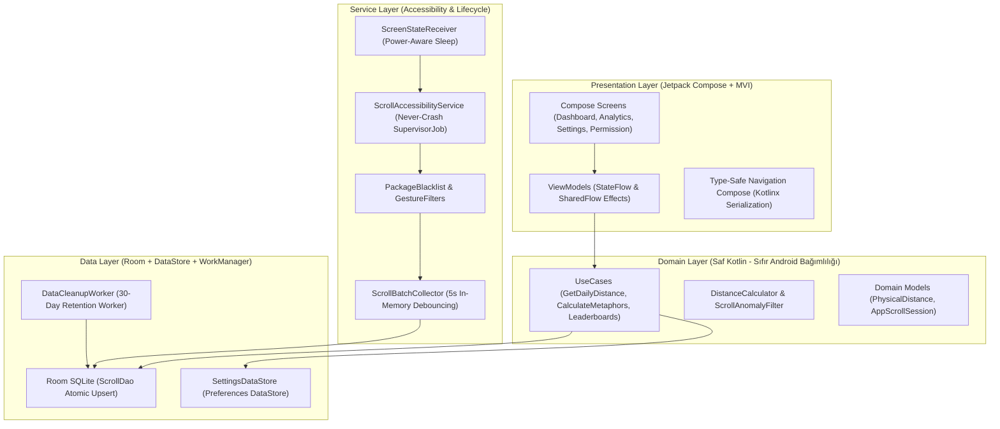

<div align="center">

# 📱 Scroll-Meter

### **Physical Distance Telemetry & Digital Well-being Tracker for Android**
*Günde kaç metre veya kilometre kaydırdığınızı hiç merak ettiniz mi?*

<br/>

[-00F5A0?style=for-the-badge&labelColor=0A0E14&color=00F5A0)](https://github.com/BurakYildizGameDev/Scroll-Meter/releases/latest/download/app-release.apk)
[](https://github.com/BurakYildizGameDev/Scroll-Meter/releases)
[](https://github.com/BurakYildizGameDev/Scroll-Meter/stargazers)

<br/>

[](https://kotlinlang.org)
[-brightgreen.svg?style=flat-square&logo=android)](https://developer.android.com)
[](https://developer.android.com/jetpack/compose)
[](https://github.com)
[](https://github.com)
[](https://github.com)
[](LICENSE)

<br/>

> **Scroll-Meter**, tüm sosyal medya ve uygulamalarınızdaki (Instagram, TikTok, X, YouTube, Reddit vb.) dikey kaydırma mesafenizi piksel piksel takip edip **gerçek dünya fiziksel metriklerine (metre ve kilometre)** dönüştüren, oyunlaştırılmış ve %100 gizlilik odaklı kurumsal bir Android telemetri uygulamasıdır.

</div>

---

## 📥 Hemen İndir ve Kur (Download & Install)

Telefonunuza doğrudan indirip hemen kullanmaya başlayabilirsiniz:

| Sürüm | Paket | Boyut | İndirme Bağlantısı |
| :--- | :--- | :---: | :---: |
| **v1.0.0 (Official Release)** | `app-release.apk` | **~3.3 MB** | [👉 **Hemen İndir (.apk)**](https://github.com/BurakYildizGameDev/Scroll-Meter/releases/latest/download/app-release.apk) |
| **Tüm Sürümler & Changelog** | GitHub Releases | — | [📦 **Releases Sayfası**](https://github.com/BurakYildizGameDev/Scroll-Meter/releases) |

### 📲 Kurulum Adımları (3 Basit Adım)
1. Yukarıdaki **[Hemen İndir](https://github.com/BurakYildizGameDev/Scroll-Meter/releases/latest/download/app-release.apk)** butonuna basarak `app-release.apk` dosyasını telefonunuza indirin.
2. İndirilen dosyaya dokunun. Android uyarısı çıkarsa *"Bilinmeyen kaynaklardan yüklemeye izin ver"* seçeneğini onaylayın.
3. **Scroll-Meter**'ı açın ve yönlendirildiğiniz sistem ayarlarından **Scroll-Meter Erişilebilirlik Servisi**'ni aktif edin. Telemetriniz anında işlemeye başlayacaktır!

---

## ✨ Öne Çıkan Özellikler

* **🛡️ %100 Sıfır İnternet & Mutlak Gizlilik (Privacy First)**:
  * Uygulamanın `AndroidManifest.xml` dosyasında **`INTERNET` izni kesinlikle bulunmaz**. Cihaz dışına 1 byte bile veri gönderilemez.
  * `canRetrieveWindowContent="false"` garantisi ile ekrandaki metinler, şifreler, sohbetler veya kişisel içerikler **asla okunamaz**.
  * Veriler sadece cihazınızın yerel donanımında şifreli SQLite veritabanında saklanır.
* **🎯 Ekrana Cetvel Koyarak Milimetrik Kalibrasyon**:
  * Telefonunuzun donanımsal PPI / DPI değerinden yola çıkarak pikseli gerçek milimetreye çevirir.
  * **İnteraktif Sanal Cetvel**: Ekranınıza gerçek bir fiziksel cetvel koyup kaydırma slider'ı ile mikrometrik eşitleme yapabilirsiniz.
* **🏆 Oyunlaştırılmış Landmark Metaforları**:
  * Gün içinde kaydırdığınız mesafeyi eğlenceli gerçek dünya hedefleriyle kıyaslar:
    * 🦒 **Zürafa** (5.5 metre)
    * 🗽 **Özgürlük Heykeli** (93 metre)
    * 🗼 **Eyfel Kulesi** (330 metre)
    * 🏙️ **Burç Halife** (828 metre)
    * 🏔️ **Everest Tepesi** (8,848 metre)
* **⚡ Cyber Luxury & Mineral Glow Tasarım Dili (Gen Z Aesthetics)**:
  * Gece derinliğinde AMOLED siyah zemin (`Obsidian Void`).
  * Dopamin tipografi, Bento Grid 2.0 kart düzeni ve zümrüt/turkuaz mineral parıltısı.
  * Compose Canvas ile çizilmiş 240° açık yay dairesel gösterge (`CircularDistanceProgress`).
  * Harici hiçbir grafik kütüphanesi olmadan saf Canvas üzerinde çalışan donanım hızlandırmalı çubuk grafik (`ScrollDistanceBarChart`).
* **🔋 "Never-Crash" ve Pil Dostu Mimari**:
  * Her kaydırma olayında veritabanı yormak yerine **5 saniyelik debounced batch toplama** motoru kullanır.
  * Ekran kapandığında (`ACTION_SCREEN_OFF`) servis uyku moduna geçer, sıfır arka plan pili tüketir.
  * 30 günden eski loglar, sadece gece telefon şarjdayken `WorkManager` tarafından temizlenir.
* **🪶 Ultra-Hafif 3.3 MB Boyut**:
  * ProGuard ve R8 optimizasyonu sayesinde 61 MB debug paketi %94.5 küçültülerek **3.3 MB** seviyesine indirilmiştir.
  * ART Baseline Profiles ile soğuk açılış süresi %30 hızlandırılmıştır.

---

## 🏛️ Mimari ve Teknoloji Yığını

Scroll-Meter, **Enterprise Clean Architecture** ve reaktif **MVI (Model-View-Intent)** prensiplerine göre katmanlandırılmıştır.



### Teknoloji Detayları
* **Programlama Dili:** Kotlin 2.0.21
* **Arayüz:** Jetpack Compose BOM 2024.10.00 (Material Design 3)
* **Navigasyon:** Navigation Compose 2.8.3 (Kotlinx Serialization Tip-Güvenli Rotalar)
* **Bağımlılık Enjeksiyonu:** Dagger-Hilt 2.52 (`@HiltViewModel`, `@HiltWorker`)
* **Yerel Veritabanı:** Room 2.6.1 SQLite (`ON CONFLICT DO UPDATE` atomik upsert)
* **Hafif Depolama:** Jetpack Preferences DataStore
* **Arka Plan Yönetimi:** AndroidX WorkManager 2.9.1
* **Birim ve Servis Testleri:** JUnit 5, MockK, Turbine, Robolectric 4.13, Coroutines Test Dispatchers

---

## ❓ Sıkça Sorulan Sorular (FAQ)

<details>
<summary><b>1. Mesajlarımı veya şifrelerimi okuyabilir mi?</b></summary>
<br/>
<b>Kesinlikle hayır!</b> Scroll-Meter'ın erişilebilirlik konfigürasyonunda <code>canRetrieveWindowContent="false"</code> kuralı zorunludur. Android işletim sistemi bu izin olmadan ekrandaki hiçbir metni veya bileşeni uygulamaya iletmez. Ayrıca uygulamada <code>INTERNET</code> izni bulunmadığından verilerin dışarı çıkması teknik olarak imkansızdır.
</details>

<details>
<summary><b>2. Şarjımı çabuk bitirir mi?</b></summary>
<br/>
<b>Hayır!</b> Gelen kaydırma olayları RAM üzerinde 5 saniyelik tamponda toplanır ve tek bir veritabanı işlemiyle kaydedilir. Ekran kapatıldığı an servis tüm hesaplamaları durdurur. Veritabanı temizliği ise sadece telefon şarjdayken ve boştayken çalışır.
</details>

<details>
<summary><b>3. Cetvel kalibrasyonu ne işe yarar?</b></summary>
<br/>
Her Android telefon üreticisinin bildirdiği ekran PPI değeri küçük sapmalar içerebilir. Ayarlar menüsündeki sanal cetvelin üzerine gerçek bir fiziksel cetvel koyup sürgüyü kaydırarak 10 santimetreyi tam olarak eşitleyebilir, böylece ölçümlerinizin milimetrik doğruluğundan emin olabilirsiniz.
</details>

---

## 🧪 Test Kapsamı ve Kalite Doğrulaması

Proje geliştirme sürecinde 60 fazın tamamı Test Güdümlü Geliştirme (TDD) ile inşa edilmiş olup **77 adet testin %100'ü başarıyla geçmektedir**:

```
================================================================================
Test Sınıfı                                                    Test     Sonuç
================================================================================
com.scrollmeter.app.core.result.ResultTest                       6      BAŞARILI
com.scrollmeter.app.data.local.dao.ScrollDaoTest                 3      BAŞARILI
com.scrollmeter.app.data.repository.ScrollRepositoryImplTest     3      BAŞARILI
com.scrollmeter.app.data.worker.DataCleanupWorkerTest            2      BAŞARILI
com.scrollmeter.app.domain.calculator.DistanceCalculatorTest    10      BAŞARILI
com.scrollmeter.app.domain.filter.ScrollAnomalyFilterTest       13      BAŞARILI
com.scrollmeter.app.domain.usecase.CalculateMetaphorUseCaseTest  3      BAŞARILI
com.scrollmeter.app.domain.usecase.GetAppLeaderboardUseCaseTest  1      BAŞARILI
com.scrollmeter.app.domain.usecase.GetDailyTotalDistance...      1      BAŞARILI
com.scrollmeter.app.presentation.analytics.AnalyticsViewModelTest 2     BAŞARILI
com.scrollmeter.app.presentation.dashboard.DashboardViewModelTest 2     BAŞARILI
com.scrollmeter.app.presentation.navigation.RoutesTest           1      BAŞARILI
com.scrollmeter.app.presentation.settings.SettingsViewModelTest  3      BAŞARILI
com.scrollmeter.app.presentation.theme.ThemeTest                 2      BAŞARILI
com.scrollmeter.app.service.batch.ScrollBatchCollectorTest       6      BAŞARILI
com.scrollmeter.app.service.filter.PackageBlacklistTest          3      BAŞARILI
com.scrollmeter.app.service.filter.ScrollGestureFilterTest       5      BAŞARILI
com.scrollmeter.app.service.notification.ScrollNotification...   2      BAŞARILI
com.scrollmeter.app.service.receiver.ScreenStateReceiverTest     4      BAŞARILI
com.scrollmeter.app.service.ScrollAccessibilityServiceTest       5      BAŞARILI
================================================================================
TOPLAM: 77 TEST | 77 BAŞARILI (%100 YEŞİL) | 0 HATA | 0 BAŞARISIZ
================================================================================
```

---

## 🛠️ Kaynak Koddan Derleme (Build from Source)

```bash
# Depoyu klonlayın
git clone https://github.com/BurakYildizGameDev/Scroll-Meter.git
cd Scroll-Meter

# Testleri koşturun
./gradlew testDebugUnitTest

# Debug APK derleyin
./gradlew assembleDebug

# Optimize edilmiş Release APK derleyin (3.3 MB)
./gradlew assembleRelease
```

---

## 📄 Lisans

Bu proje **Apache License 2.0** kapsamında lisanslanmıştır. Detaylar için [`LICENSE`](LICENSE) dosyasını inceleyebilirsiniz.

---

<div align="center">

### ⭐ Beğendiyseniz depoya bir yıldız bırakmayı unutmayın!

Crafted with ❤️ by **Burak Yıldız**  
[](https://github.com/BurakYildizGameDev)
[](https://github.com/BurakYildizGameDev/Scroll-Meter/releases)

</div>
