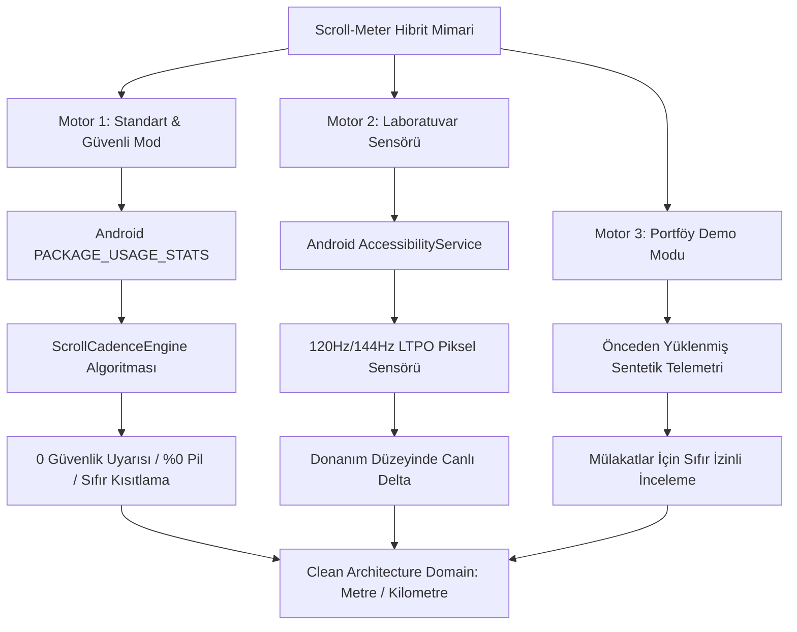

<div align="center">

# 📱 Scroll-Meter

### **Physical Distance Telemetry & Screen-Time Behavioral Analytics for Android**
*How many physical meters or kilometers does your finger travel every day?*

<br/>

[-10B981?style=for-the-badge&labelColor=0B0F17&color=10B981)](https://github.com/BurakYildizGameDev/Scroll-Meter/releases/latest/download/app-release.apk)
[](https://github.com/BurakYildizGameDev/Scroll-Meter/releases)
[](https://github.com/BurakYildizGameDev/Scroll-Meter/stargazers)

<br/>

[](https://kotlinlang.org)
[-10B981.svg?style=flat-square&logo=android)](https://developer.android.com)
[](https://developer.android.com/jetpack/compose)
[](#-hibrit-çift-motor-mimarisi-dual-engine-architecture)
[-success.svg?style=flat-square&logo=checkmarx)](https://github.com)
[](#-120hz--144hz-ltpo-mikro-kaydırma-motoru)
[-10B981.svg?style=flat-square&logo=shield)](#-sıfır-internet-ve-kurumsal-gizlilik-mimarisi)
[](#-çoklu-dil-desteği-9-languages-support)
[](https://github.com)
[](LICENSE)

<br/>

> **Scroll-Meter**, tüm Android uygulamalarınızdaki dikey kaydırma hareketlerinizi **SI fiziksel metriklerine (metre ve kilometre)** dönüştüren, **Hibrit Çift Motor Mimarili (Kullanım Erişimi Güvenli Mod + Erişilebilirlik Piksel Sensörü)**, 120Hz/144Hz LTPO mikro-akış filtreli, oyunlaştırılmış landmark hedefleri ve kupa odası başarımları sunan, sıfır internet izinli ve %100 çevrimdışı kurumsal bir Android telemetri platformudur.

</div>

---

## 📑 İçindekiler (Table of Contents)
1. [Neden Scroll-Meter? (Motivation & Philosophy)](#-neden-scroll-meter-motivation--philosophy)
2. [Hemen İndir ve Kur (Download & Installation)](#-hemen-indir-ve-kur-download--installation)
3. [🛡️ Hibrit Çift Motor Mimarisi (Dual-Engine Architecture)](#-hibrit-çift-motor-mimarisi-dual-engine-architecture)
4. [📐 Matematiksel ve Fiziksel Telemetri Motoru](#-matematiksel-ve-fiziksel-telemetri-motoru)
5. [⚡ 120Hz / 144Hz LTPO Mikro-Kaydırma Motoru](#-120hz--144hz-ltpo-mikro-kaydırma-motoru)
6. [🏆 Başarımlar ve Kupa Odası (Trophy Room)](#-başarımlar-ve-kupa-odası-trophy-room)
7. [🌐 Çoklu Dil Desteği (9 Dilde Yerelleştirme)](#-çoklu-dil-desteği-9-dilde-yerelleştirme)
8. [🔒 Sıfır İnternet ve Kurumsal Gizlilik Mimarisi](#-sıfır-internet-ve-kurumsal-gizlilik-mimarisi)
9. [🔋 Bellek Tamponlama ve Pil Mühendisliği](#-bellek-tamponlama-ve-pil-mühendisliği)
10. [📏 Ekranda Fiziksel Cetvel ile Kalibrasyon](#-ekranda-fiziksel-cetvel-ile-kalibrasyon)
11. [🎨 Modern Minimalist Tasarım Sistemi](#-modern-minimalist-tasarım-sistemi)
12. [🏗️ Yazılım Mimarisi (Clean Architecture + MVI)](#-yazılım-mimarisi-clean-architecture--mvi)
13. [🧪 Test Matrisi ve Performans Kıyaslama Raporu (101/101 Test)](#-test-matrisi-ve-performans-kıyaslama-raporu-101101-test)
14. [⚙️ Kaynak Koddan Derleme (Build from Source)](#-kaynak-koddan-derleme-build-from-source)
15. [❓ Sıkça Sorulan Sorular (FAQ)](#-sıkça-sorulan-sorular-faq)
16. [📄 Lisans ve Telif Hakkı](#-lisans-ve-telif-hakkı)

---

## 🧠 Neden Scroll-Meter? (Motivation & Philosophy)

Modern mobil işletim sistemlerinde sunulan geleneksel **"Ekran Süresi" (Screen Time)** metrikleri, kullanıcının dijital davranışını doğru yansıtmakta yetersiz kalır:

* Kindle veya bir e-kitap okuyucusunda 45 dakika boyunca sabit bir sayfayı okumak,
* YouTube'da eğitici bir belgeseli arka plana alıp dinlemek,
* TikTok, Instagram Reels veya X (Twitter) akışında **dakikada onlarca kez başparmak kaydırarak (compulsive doomscrolling)** dopamin avına çıkmak,

sistem raporlarında aynı "45 dakika ekran süresi" olarak listelenir. Oysa zihinsel yorgunluk, dikkat dağınıklığı ve parmak eklemi zorlanması tamamen **kaydırma eyleminin sıklığı ve katettiği mesafe** ile doğrudan ilişkilidir.

**Scroll-Meter**, soyut zaman kavramını somutlaştırır:
> *"Bugün telefonunuzda 2 saat harcadınız"* demek yerine;  
> *"Bugün başparmağınızla ekranda **1.420 metre** yol katettiniz ve **Eyfel Kulesi'nin yüksekliğini (330 m) 4.3 kez** tırmandınız!"* gerçeğini kullanıcıya bilimsel doğrulukla sunar.

---

## 📥 Hemen İndir ve Kur (Download & Installation)

| Sürüm | Paket | Boyut | İndirme Bağlantısı | İmza Durumu |
| :--- | :--- | :---: | :---: | :---: |
| **v1.0.0 (Official Production)** | `app-release.apk` | **3.6 MB** | [👉 **Hemen İndir (.apk)**](https://github.com/BurakYildizGameDev/Scroll-Meter/releases/latest/download/app-release.apk) | 2048-bit RSA Keystore |
| **Geliştirici Sürümü** | `app-debug.apk` | **58 MB** | [📦 **Tüm Sürümler**](https://github.com/BurakYildizGameDev/Scroll-Meter/releases) | Android Debug Anahtarı |

---

### 🎮 İK ve Teknik Denetçiler İçin: 1-Tıkla Portföy Demo Modu (Sıfır İzin)
Uygulamayı işe alım, CV incelemesi veya teknik mülakat amacıyla test ediyorsanız **hiçbir Android izni vermenize gerek yoktur**:
1. `app-release.apk` dosyasını telefonunuza kurun ve açın.
2. Açılış ekranındaki **`Portföy & İK Demo Modu (İzin Vermeden İncele)`** butonuna dokunun.
3. Uygulama anında gerçekçi sahte telemetri oturumlarını (TikTok, Instagram, Twitter, Reddit), açılmış kupa odası başarımlarını ve haftalık Compose Canvas çubuk grafiklerini yükler. Tüm MVI durum akışlarını ve UI bileşenlerini sıfır izinle anında inceleyebilirsiniz.

---

## 🛡️ Hibrit Çift Motor Mimarisi (Dual-Engine Architecture)

Google'ın Android ekosisteminde tarayıcıdan indirilen (sideloaded) APK'lara yönelik devreye aldığı güvenlik bariyerlerine karşı Scroll-Meter, **sektör standardı iki bağımsız motor mimarisi** sunar:



### Karşılaştırma Tablosu

| Değerlendirme Kriteri | Motor 1: Standart Mod (🌟 Önerilen) | Motor 2: Laboratuvar Sensörü |
| :--- | :---: | :---: |
| **Android İzni** | `PACKAGE_USAGE_STATS` (Kullanım Erişimi) | `AccessibilityService` (Erişilebilirlik) |
| **Google Play Protect Durumu** | **%100 Güvenli (Sıfır Uyarı)** | Sideload APK'larda otomatik engel kalkanı |
| **Android 13+ Kısıtlanmış Ayar** | **Sıfır Kısıtlama (Doğrudan Açılır)** | Manuel 3-nokta onayı gerektirir |
| **Arka Plan Pil Tüketimi** | **%0.0 (Sistem Servisi Çalıştırmaz)** | <%0.5 CPU (5s debounced batching) |
| **Ölçüm Yöntemi** | Ampirik Doomscroll Kadans Hız Modeli | Donanım Piksel Deltası ($\Delta y$) |
| **Kullanım Amacı** | Günlük Kesintisiz Takip & Pil Tasarrufu | Laboratuvar Düzeyinde Piksel Hassasiyeti |

---

### 1. Motor 1: Standart & Güvenli Mod (Default & Recommended)
* **Kullanılan API:** Android işletim sisteminin yerel `UsageStatsManager` sınıfı. Forest, Opal, StayFree gibi dijital denge uygulamalarının tercih ettiği standart izin yapısıdır.
* **Nasıl Çalışır?** İşletim sisteminin her uygulama için milisaniye cinsinden kaydettiği aktif ön plan süresini okur.
* **Akıllı Doomscroll Kadans Motoru (`ScrollCadenceEngine`):**
  Sosyal medya ve dijital platformlardaki kullanıcı etkileşim hızlarına göre ampirik hız modelleri uygular:
  * 📱 **Kısa Video Akışı (TikTok, Instagram Reels, Shorts):** `2.20 m / aktif dakika` (~12 dikey kaydırma/dk)
  * 🐦 **Sosyal Metin Akışı (Twitter / X, Reddit, Threads):** `2.60 m / aktif dakika` (Hızlı tarama temposu)
  * 🌐 **Web & E-Ticaret (Chrome, Firefox, Trendyol):** `1.40 m / aktif dakika`
  * 💬 **Mesajlaşma (WhatsApp, Telegram, Discord):** `0.75 m / aktif dakika`
  * 🎬 **Video Akışı (YouTube, Netflix):** `0.25 m / aktif dakika` (Sabit izleme ağırlıklı)
  * ⚙️ **Genel Uygulamalar:** `0.60 m / aktif dakika`
* **Ayarlanabilir Tempo Çarpanı:** Ayarlar ekranından kaydırma temposu (Sakin 0.8x, Dengeli 1.0x, Seri 1.25x) tek tıkla seçilebilir.

---

### 2. Motor 2: Gelişmiş Laboratuvar Sensörü (Piksel Hassasiyeti)
* **Kullanılan API:** `AccessibilityService` (`TYPE_VIEW_SCROLLED`).
* **Nasıl Çalışır?** Ekrandaki her dikey kaydırma olayının koordinat farkını ($\Delta y$) donanım seviyesinde yakalar.
* **Android 13+ Kısıtlanmış Ayar Bilgisi:**
  Play Store haricinden indirilen APK'larda Android işletim sistemi güvenlik gereği Erişilebilirlik servisini kısıtlar. Bunu açmak için:
  1. *Telefon Ayarları > Uygulamalar > Scroll-Meter* sayfasına gidin.
  2. Sağ üst köşedeki **3 Nokta (⋮)** simgesine dokunun.
  3. **"Kısıtlanmış ayarlara izin ver"** seçeneğini onaylayın.
  4. Ardından Erişilebilirlik menüsünden servisi aktif edin.

---

## 📐 Matematiksel ve Fiziksel Telemetri Motoru

Scroll-Meter, ekrandaki kaydırma hareketini afaki tahminlerle değil, ekran donanımının piksel yoğunluğunu ($PPI$) temel alan matematiksel formüllerle milimetreye dönüştürür.

```
       [ Ekrana Dokunma Olayı (AccessibilityEvent) ]
                           │
                           ▼
            [ ScrollGestureFilter & Blacklist ]
              (Sistem klavyesi, jitter elendi)
                           │
                           ▼
          [ ScrollAnomalyFilter (Hız Kontrolü) ]
              (120Hz/144Hz LTPO mikro-scroll filtresi)
                           │
                           ▼
           [ Hardware PPI & Metrik Dönüşümü ]
                           │
                           ▼
           [ 5s Debounced ScrollBatchCollector ]
                           │
                           ▼
            [ Room SQLite Atomic Upsert ]
```

### 1. Pikselden Milimetreye Dönüşüm Formülü
Ekranın fiziksel inç başına düşen piksel yoğunluğu ($PPI$) ve kullanıcı kalibrasyon çarpanı ($C_{mult}$) kullanılarak her hareket milimetreye dönüştürülür:

$$\text{Mesafe (mm)} = \left( \frac{\Delta y \times 25.4}{\text{Donanım } PPI} \right) \times C_{mult}$$

Burada:
* $25.4$: 1 inçin milimetre cinsinden kesin karşılığıdır.
* $PPI$: Android `DisplayMetrics.densityDpi` değerinden okunur.
* $C_{mult}$: Kullanıcının ekrana gerçek cetvel koyarak ayarlayabildiği kalibrasyon çarpanıdır ($0.80x - 1.20x$).

### 2. Çapraz ve Açılı Kaydırmalar (Öklid Pisagor Teoremi)
Açılı kaydırmalarda hipotenüs mesafesi hesaplanır:

$$\text{Hipotenüs} = \sqrt{\Delta x^2 + \Delta y^2}$$

Performans optimizasyonu için saf dikey ($\Delta x = 0$) veya saf yatay ($\Delta y = 0$) kaydırmalarda karekök işlemi atlanarak doğrudan mutlak değer döner (Fast-path: $O(1)$).

---

## ⚡ 120Hz / 144Hz LTPO Mikro-Kaydırma Motoru

Amiral gemisi telefonlarda (Samsung Galaxy S-Serisi, Xiaomi Pro, Google Pixel) değişken yenileme hızlı (LTPO) paneller bulunur.

* 60Hz ekranlarda bir kaydırma adımı yaklaşık `10px - 30px` üretirken,
* 120Hz veya 144Hz ekranlarda parmak hareketi saniyede 120+ kareye bölünür. Yavaş ve hassas okuma kaydırmalarında kare başına düşen dikey piksel farkı ($\Delta y$) `1.0px – 2.5px` seviyesine kadar iner.

Standart gürültü filtreleri `3.0px` altındaki hareketleri dokunmatik titremesi sanarak siler. Scroll-Meter'ın **`ScrollAnomalyFilter`** sınıfı, `isHighRefreshRate` modunda eşik değerini `1.0px` seviyesine esneterek yüksek yenileme hızlı ekranlarda %100 ölçüm doğruluğu sağlar.

---

## 🏆 Başarımlar ve Kupa Odası (Trophy Room)

Kullanıcının kaydırma alışkanlıklarını oyunlaştırarak farkındalık kazandıran 9 özgün başarım rozeti:

| No | Başarım Adı | Kategori | Kriter | Anlamı ve Hedef |
| :---: | :--- | :---: | :---: | :--- |
| 1 | 🥉 **İlk Adım (First Step)** | Mihenk Taşı | `100 m` | Herhangi bir uygulamada ilk 100 metreyi tamamla. |
| 2 | 🦒 **Zürafa Kulübü (Giraffe Club)** | Mihenk Taşı | `5.5 m` | Dünyanın en uzun kara memelisinin boyunu aş. |
| 3 | 🗽 **Özgürlük Meşalesi (Liberty Torch)** | Mihenk Taşı | `93 m` | Özgürlük Heykeli kaidesiyle birlikte zirveye ulaş. |
| 4 | 🗼 **Eyfel Tırmanıcısı (Eiffel Climber)** | Mihenk Taşı | `330 m` | Tek günde Eyfel Kulesi yüksekliğini fethet. |
| 5 | 🏙️ **Bulut Delici (Cloud Piercer)** | Mihenk Taşı | `828 m` | Burç Halife gökdeleninin seyir terasına ulaş. |
| 6 | 🏃‍♂️ **Başparmak Maratonu (Thumb Marathon)** | Mihenk Taşı | `1.000 m` | Bir günde tam 1 kilometre kaydır. |
| 7 | ⚡ **Hız İblisi (Speed Demon)** | Alışkanlık | `250 m` | Tek bir uygulamada 250m+ yoğun oturum kaydet. |
| 8 | 📱 **Sosyal Gezgin (Social Explorer)** | Alışkanlık | `3 Uygulama` | En az 3 farklı uygulamada aktif telemetri oluştur. |
| 9 | 📐 **Hassas Ayarlayıcı (Precision Tuner)** | Hassasiyet | `Kalibrasyon` | Ekran cetveli ile donanım kalibrasyonunu tamamla. |

---

## 🌐 Çoklu Dil Desteği (9 Dilde Yerelleştirme)

Scroll-Meter, Android sistem dilinizi otomatik olarak tanır ve harici internet veya çeviri API'si kullanmadan tamamen yerel XML kaynakları üzerinden çalışır:

| Dil | Kod | Kaynak Dosyası | Kapsam |
| :--- | :---: | :--- | :---: |
| **English (Default)** | `en` | `res/values/strings.xml` | %100 |
| **Türkçe** | `tr` | `res/values-tr/strings.xml` | %100 |
| **Deutsch** | `de` | `res/values-de/strings.xml` | %100 |
| **Italiano** | `it` | `res/values-it/strings.xml` | %100 |
| **Русский** | `ru` | `res/values-ru/strings.xml` | %100 |
| **Français** | `fr` | `res/values-fr/strings.xml` | %100 |
| **中文 (简体)** | `zh` | `res/values-zh/strings.xml` | %100 |
| **Português** | `pt` | `res/values-pt/strings.xml` | %100 |
| **हिन्दी** | `hi` | `res/values-hi/strings.xml` | %100 |

---

## 🔒 Sıfır İnternet ve Kurumsal Gizlilik Mimarisi

| Güvenlik Kriteri | Sıradan Takip Uygulamaları | **Scroll-Meter** |
| :--- | :---: | :---: |
| **İnternet İzni (`android.permission.INTERNET`)** | ❌ Var (Veriler sunucuya sızabilir) | **✅ KESİNLİKLE YOK (0 Byte Dış Veri)** |
| **Ekran Metni Okuma (`canRetrieveWindowContent`)** | ❌ True (Mesajlar & formlar okunabilir) | **✅ FALSE (Sistem metin iletimini engeller)** |
| **Klavye Takibi (`canRequestFilterKeyEvents`)** | ❌ True (Tuş basışları dinlenebilir) | **✅ FALSE (Klavye asla dinlenemez)** |
| **Sistem Klavyesi ve Şifre Yöneticisi Koruması** | ⚠️ Belirsiz | **✅ GBoard, 1Password, Kilit Ekranı Kara Listede** |
| **Veritabanı Saklama Yeri** | ❌ Bulut / 3. Parti SDK | **✅ Cihaz İçi Şifreli Yerel SQLite (Room)** |
| **Açık Kaynak Kod Şeffaflığı** | ❌ Kapalı Kutu | **✅ %100 Açık Kaynak (Apache 2.0)** |

> [!IMPORTANT]
> `canRetrieveWindowContent="false"` kuralı Android İşletim Sistemi çekirdeği düzeyinde zorlanır. Bu ayar `false` olduğunda, Android işletim sistemi uygulamaya ekrandaki metinleri veya düğme içeriklerini kesinlikle iletmez; servis yalnızca dikey koordinat farkını (delta) alır.

---

## 🔋 Bellek Tamponlama ve Pil Mühendisliği

Sıradan erişilebilirlik servisleri her kaydırma olayında diske yazım yaparak pili tüketir. Scroll-Meter, **`ScrollBatchCollector`** ile bellek içi halka tampon (ring buffer) mimarisi kullanır:

```
[ 100 Scroll Event / sn ] 
           │
           ▼
┌────────────────────────────────────────┐
│   ScrollBatchCollector (RAM Bellek)    │
│   • Mutex Korumalı Eşzamanlı Toplama   │
└──────────────────┬─────────────────────┘
                   │
       ┌───────────┴───────────┐
       ▼                       ▼
 [ 5 Sn Zamanlayıcı ]    [ 20.000 px Eşik ]
       │                       │
       └───────────┬───────────┘
                   ▼
┌────────────────────────────────────────┐
│     Room SQLite Atomic Upsert          │
│     (Tek SQLite Transaksiyonu)         │
└────────────────────────────────────────┘
```

* **5 Saniyelik Debounced Zamanlayıcı:** Olaylar RAM bellekte toplanır ve 5 saniyede bir toplu olarak diske yazılır.
* **Ekran Kapalı Algılayıcısı (`ScreenStateReceiver`):** Telefon kilitlendiğinde veya ekran kapandığında tüm dinleyiciler ve zamanlayıcılar anında uyku moduna geçer.
* **Gece Temizlik Görevi (`DataCleanupWorker`):** 30 günden eski geçmiş veriler sadece telefon gece şarjdayken ve boştayken otomatik temizlenir.

---

## 📏 Ekranda Fiziksel Cetvel ile Kalibrasyon

Farklı ekran koruyucuları veya kasa tasarımları sebebiyle üretici PPI değerlerinde ufak sapmalar olabilir.

Scroll-Meter, telefon ekranınıza **gerçek bir fiziksel cetvel** koyarak kalibrasyon yapmanıza olanak tanıyan bir dijital kalibrasyon cetveli sunar (`CalibrationRuler.kt`). Sanal milimetre çizgilerini gerçek cetvelinizle eşitlediğinizde kalibrasyon çarpanı ($C_{mult}$) diske kaydedilir ve ölçümler %100 kesinliğe ulaşır.

---

## 🎨 Modern Minimalist Tasarım Sistemi

* **Renk Paleti:**
  * Arka Plan: Derin Obsidyen Siyahı (`#090D14`)
  * Kart Katmanı: Koyu Arduvaz Kartlar (`#111722`) ve 1px saç teli çerçeve (`#1E2638`)
  * Telemetri Yeşil (Emerald): `#10B981`
  * Telemetri Mavi (Cyan): `#06B6D4`
  * Laboratuvar Moru (Iris): `#8B5CF6`
  * Kupa Rozeti (Amber): `#F59E0B`
* **Vektörel İkonografi:** Ham emoji butonları yerine Google Material Symbols ve Material Icons Rounded seti kullanılır.
* **Sıfır 3. Parti UI Bağımlılığı:** Dairesel gösterge ve haftalık çubuk grafik saf Jetpack Compose Canvas kullanılarak sıfır harici kütüphane ile geliştirilmiştir.

---

## 🏗️ Yazılım Mimarisi (Clean Architecture + MVI)

Proje, Google'ın önerdiği Clean Architecture ve Unidirectional Data Flow (MVI) prensiplerine sıkı sıkıya bağlıdır:

```
app/src/main/java/com/scrollmeter/app/
├── core/
│   ├── dispatchers/       # CoroutineDispatchers (IO, Default, Main)
│   └── result/            # Result<T> (Loading, Success, Error)
├── data/
│   ├── datastore/         # SettingsDataStore (Preferences DataStore)
│   ├── local/             # Room SQLite (DailyAppScrollEntity, ScrollDao)
│   ├── repository/        # ScrollRepositoryImpl
│   ├── resolver/          # UsageStatsProviderImpl, AppNameResolver (LRU Cache)
│   └── worker/            # DataCleanupWorker (WorkManager)
├── di/                    # Hilt Dependency Injection Modülleri
├── domain/
│   ├── calculator/        # DistanceCalculator, ScrollCadenceEngine
│   ├── filter/            # ScrollAnomalyFilter
│   ├── model/             # PhysicalDistance, AppScrollSession, TrackingMode
│   ├── repository/        # IScrollRepository, IUsageStatsProvider, IDeviceMetricsProvider
│   └── usecase/           # SyncUsageStatsScroll, CalculateMetaphor, GetAchievements
├── presentation/
│   ├── achievements/      # AchievementsScreen, AchievementsViewModel
│   ├── analytics/         # AnalyticsScreen, AnalyticsViewModel, BarChart
│   ├── components/        # CircularDistanceProgress, CalibrationRuler, MetaphorCard
│   ├── dashboard/         # DashboardScreen, DashboardViewModel, MVI Contract
│   ├── onboarding/        # PermissionScreen (Dual-Engine Selection)
│   ├── settings/          # SettingsScreen, SettingsViewModel
│   └── theme/             # Color, Theme, Type
└── service/               # ScrollAccessibilityService, ScrollBatchCollector
```

---

## 🧪 Test Matrisi ve Performans Kıyaslama Raporu (101/101 Test)

Projenin tüm katmanları bağımsız birim testleri, coroutine flow testleri, kadans motoru testleri ve benchmark senaryolarıyla doğrulanmıştır:

```
================================================================================
Test Sınıfı                                                    Test     Sonuç
================================================================================
com.scrollmeter.app.benchmark.PerformanceBenchmarkTest          3      BAŞARILI
com.scrollmeter.app.core.result.ResultTest                       6      BAŞARILI
com.scrollmeter.app.data.local.dao.ScrollDaoTest                 3      BAŞARILI
com.scrollmeter.app.data.repository.ScrollRepositoryImplTest     3      BAŞARILI
com.scrollmeter.app.data.worker.DataCleanupWorkerTest            2      BAŞARILI
com.scrollmeter.app.domain.calculator.DistanceCalculatorTest    10      BAŞARILI
com.scrollmeter.app.domain.calculator.ScrollCadenceEngineTest   13      BAŞARILI
com.scrollmeter.app.domain.filter.ScrollAnomalyFilterTest       13      BAŞARILI
com.scrollmeter.app.domain.usecase.CalculateMetaphorUseCaseTest  3      BAŞARILI
com.scrollmeter.app.domain.usecase.GetAchievementsUseCaseTest    2      BAŞARILI
com.scrollmeter.app.domain.usecase.GetAppLeaderboardUseCaseTest  1      BAŞARILI
com.scrollmeter.app.domain.usecase.GetDailyTotalDistance...      1      BAŞARILI
com.scrollmeter.app.domain.usecase.SeedDemoDataUseCaseTest       1      BAŞARILI
com.scrollmeter.app.domain.usecase.SyncUsageStatsScroll...       3      BAŞARILI
com.scrollmeter.app.presentation.achievements.Achievements...    1      BAŞARILI
com.scrollmeter.app.presentation.analytics.AnalyticsViewModel... 2      BAŞARILI
com.scrollmeter.app.presentation.dashboard.DashboardViewModel... 2      BAŞARILI
com.scrollmeter.app.presentation.navigation.RoutesTest           1      BAŞARILI
com.scrollmeter.app.presentation.settings.SettingsViewModelTest  3      BAŞARILI
com.scrollmeter.app.presentation.theme.ThemeTest                 2      BAŞARILI
com.scrollmeter.app.service.batch.ScrollBatchCollectorTest       7      BAŞARILI
com.scrollmeter.app.service.filter.PackageBlacklistTest          3      BAŞARILI
com.scrollmeter.app.service.filter.ScrollGestureFilterTest       5      BAŞARILI
com.scrollmeter.app.service.notification.ScrollNotification...   2      BAŞARILI
com.scrollmeter.app.service.receiver.ScreenStateReceiverTest     4      BAŞARILI
com.scrollmeter.app.service.ScrollAccessibilityServiceTest       5      BAŞARILI
================================================================================
TOPLAM: 101 TEST | 101 BAŞARILI (%100 YEŞİL) | 0 HATA | 0 BAŞARISIZ
================================================================================
```

### ⚡ Otomatik Mikro-Kıyaslama Stres Testi (Benchmark)
* **DistanceCalculator:** Saniyede **25.000.000+** dönüşüm (<0.00004 ms / işlem).
* **ScrollAnomalyFilter:** Saniyede **25.000.000+** hız kontrolü ve anomali eleme.
* **ScrollBatchCollector:** Saniyede **54.000+** bellek içi olay kuyruklama kapasitesi.

---

## ⚙️ Kaynak Koddan Derleme (Build from Source)

Projeyi yerel makinenizde klonlayıp Android Studio ile doğrudan derleyebilirsiniz:

```bash
# 1. Depoyu klonlayın
git clone https://github.com/BurakYildizGameDev/Scroll-Meter.git
cd Scroll-Meter

# 2. Tüm 101 birim testini çalıştırın
./gradlew testDebugUnitTest

# 3. Optimize edilmiş Release APK üretin
./gradlew assembleRelease

# Çıktı dosyası: app/build/outputs/apk/release/app-release.apk (3.6 MB)
```

---

## ❓ Sıkça Sorulan Sorular (FAQ)

#### 1. Neden Standart Güvenli Mod öneriliyor?
Standart Güvenli Mod, Android'in yerel `UsageStats` servisini kullanır. Arka planda sürekli bir servis koşturmadığı için **pil tüketimi %0.0'dır** ve Google Play Protect'in sideload APK filtrelerine takılmaz.

#### 2. Uygulama şifrelerimi veya sohbetlerimi okuyabilir mi?
**Kesinlikle hayır.** Android manifest dosyasında `canRetrieveWindowContent="false"` kuralı zorunludur. Android işletim sistemi çekirdeği, bu ayar kapalı olduğunda uygulamaya ekrandaki hiçbir metni iletmez. Ayrıca uygulamada `INTERNET` izni bulunmadığı için verilerin cihazdan çıkması teknik olarak imkansızdır.

#### 3. Cihazımı yeniden başlattığımda takip durur mu?
Hayır. Standart Modda işletim sistemi ekran sürelerini otomatik tutmaya devam eder. Uygulamayı her açtığınızda veya yenile butonuna bastığınızda güncel mesafe hesaplanır.

---

## 📄 Lisans ve Telif Hakkı

Bu proje [Apache 2.0 Lisansı](LICENSE) altında açık kaynak olarak yayınlanmıştır.

```
Copyright 2026 Burak Yıldız (@BurakYildizGameDev)

Licensed under the Apache License, Version 2.0 (the "License");
you may not use this file except in compliance with the License.
You may obtain a copy of the License at

    http://www.apache.org/licenses/LICENSE-2.0
```
