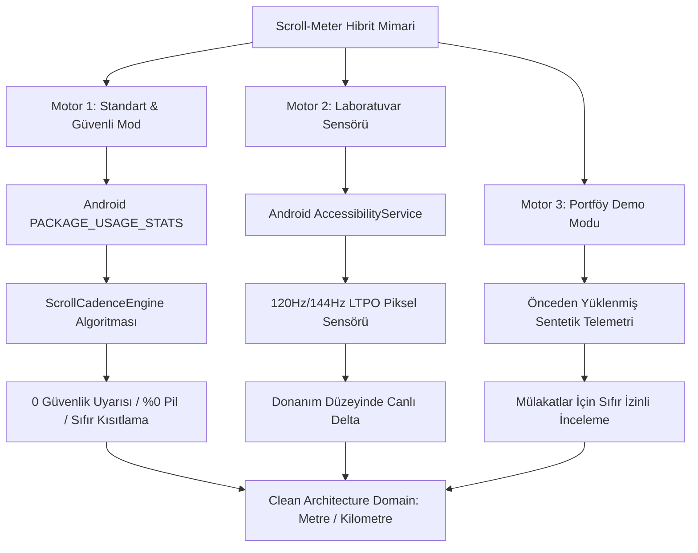
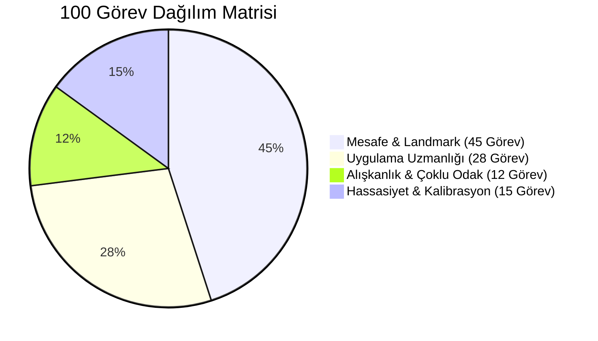
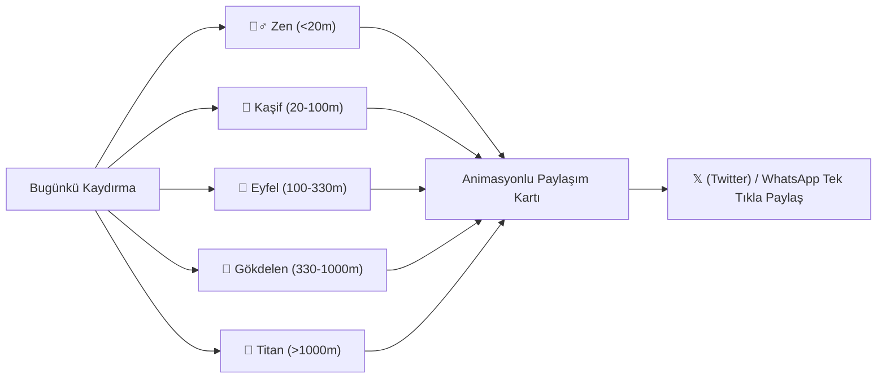

<div align="center">

# 📱 Scroll-Meter

### **Physical Distance Telemetry & Screen-Time Behavioral Analytics for Android**
*How many physical meters or kilometers does your finger travel every day?*

<br/>

[-10B981?style=for-the-badge&labelColor=0B0F17&color=10B981)](https://github.com/BurakYildizGameDev/Scroll-Meter/releases/latest/download/app-release.apk)
[](https://github.com/BurakYildizGameDev/Scroll-Meter/releases)
[](https://github.com/BurakYildizGameDev/Scroll-Meter/stargazers)

<br/>

[](https://kotlinlang.org)
[-10B981.svg?style=flat-square&logo=android)](https://developer.android.com)
[](https://developer.android.com/jetpack/compose)
[](#-hibrit-çift-motor-mimarisi-dual-engine-architecture)
[-success.svg?style=flat-square&logo=checkmarx)](https://github.com)
[](#-120hz--144hz-ltpo-mikro-kaydırma-motoru)
[-10B981.svg?style=flat-square&logo=shield)](#-sıfır-internet-ve-kurumsal-gizlilik-mimarisi)
[](#-çoklu-dil-desteği-9-languages-support)
[-orange.svg?style=flat-square&logo=android)](https://github.com)
[](LICENSE)

<br/>

> **Scroll-Meter**, tüm Android uygulamalarınızdaki dikey kaydırma hareketlerinizi **SI fiziksel metriklerine (metre ve kilometre)** dönüştüren, **Hibrit Çift Motor Mimarili (Kullanım Erişimi Güvenli Mod + Erişilebilirlik Piksel Sensörü)**, 120Hz/144Hz LTPO mikro-akış filtreli, oyunlaştırılmış landmark hedefleri ve kupa odası başarımları sunan, sıfır internet izinli ve %100 çevrimdışı kurumsal bir Android telemetri platformudur.

</div>

---

## 📑 İçindekiler (Table of Contents)
1. [Neden Scroll-Meter? Sahte Dopamin Tuzağı ve Doomscrolling Gerçeği](#-neden-scroll-meter-sahte-dopamin-tuzağı-ve-doomscrolling-gerçeği)
2. [Hemen İndir ve Kur (Download & Installation)](#-hemen-indir-ve-kur-download--installation)
3. [🛡️ Hibrit Çift Motor Mimarisi (Dual-Engine Architecture)](#-hibrit-çift-motor-mimarisi-dual-engine-architecture)
4. [📐 Matematiksel ve Fiziksel Telemetri Motoru](#-matematiksel-ve-fiziksel-telemetri-motoru)
5. [⚡ 120Hz / 144Hz LTPO Mikro-Kaydırma Motoru](#-120hz--144hz-ltpo-mikro-kaydırma-motoru)
6. [🏆 Başarımlar ve Kupa Odası (Trophy Room)](#-başarımlar-ve-kupa-odası-100-özgün-görev-trophy-room)
7. [🚀 5 Kademeli Sosyal Paylaşım & 𝕏 (Twitter) İlerleme Motoru](#-5-kademeli-sosyal-paylaşım--𝕏-twitter-ilerleme-motoru)
8. [🌐 Çoklu Dil Desteği ve Uygulama İçi Dil Değiştirici](#-çoklu-dil-desteği-ve-uygulama-içi-dil-değiştirici)
9. [📱 Paket Görünürlüğü ve Gerçek Uygulama İkonları (Android 11-14)](#-paket-görünürlüğü-ve-gerçek-uygulama-ikonları-android-11-14)
10. [🔒 Sıfır İnternet ve Kurumsal Gizlilik Mimarisi](#-sıfır-internet-ve-kurumsal-gizlilik-mimarisi)
11. [🔋 Bellek Tamponlama ve Pil Mühendisliği](#-bellek-tamponlama-ve-pil-mühendisliği)
12. [📏 Ekranda Fiziksel Cetvel ile Kalibrasyon](#-ekranda-fiziksel-cetvel-ile-kalibrasyon)
13. [🎨 Modern Minimalist Gece Mavisi Tasarım Sistemi](#-modern-minimalist-tasarım-sistemi)
14. [🏗️ Yazılım Mimarisi (Clean Architecture + MVI)](#-yazılım-mimarisi-clean-architecture--mvi)
15. [🧪 Test Matrisi ve Performans Kıyaslama Raporu (108/108 Test)](#-test-matrisi-ve-performans-kıyaslama-raporu-108108-test)
16. [⚙️ Kaynak Koddan Derleme (Build from Source)](#-kaynak-koddan-derleme-build-from-source)
17. [❓ Sıkça Sorulan Sorular (FAQ)](#-sıkça-sorulan-sorular-faq)
18. [📄 Lisans ve Telif Hakkı](#-lisans-ve-telif-hakkı)

---

## 🧠 Neden Scroll-Meter? Sahte Dopamin Tuzağı ve Doomscrolling Gerçeği

> [!IMPORTANT]
> ### 🚨 BİLİNÇLİ TEKNOLOJİ MANİFESTOSU: BU UYGULAMA BİR REKOR KIRMA OYUNU DEĞİLDİR!
> **Scroll-Meter sizi daha çok kaydırmaya asla teşvik ETMEZ.**  
> Tam aksine: Sonsuz akışların (infinite feed) yarattığı kompulsif kaydırma bağımlılığını, beyninizi kandıran sahte dopamin mekanizmasını ve gün içinde farkında olmadan parmağınızla katettiğiniz yüzlerce metreyi **görünür kılarak telefonunuzu masaya bıraktırmak ve dijital farkındalık kazandırmak** için geliştirilmiştir.

Modern mobil işletim sistemlerinde sunulan geleneksel **"Ekran Süresi" (Screen Time)** metrikleri, kullanıcının dijital davranışını ve zihinsel tahribatını doğru yansıtmakta yetersiz kalır:

* Kindle veya bir e-kitap okuyucusunda 45 dakika boyunca sabit bir sayfayı okumak,
* YouTube'da eğitici bir belgeseli arka plana alıp dinlemek,
* TikTok, Instagram Reels veya X (Twitter) akışında **dakikada onlarca kez başparmak kaydırarak (compulsive doomscrolling)** sahte dopamin avına çıkmak,

sistem raporlarında aynı "45 dakika ekran süresi" olarak listelenir. Oysa zihinsel yorgunluk, dikkat dağınıklığı ve parmak eklemi zorlanması tamamen **kaydırma eyleminin sıklığı ve katettiği fiziksel mesafe** ile doğrudan ilişkilidir.

### 🔬 Sürekli Kaydırmanın (Doomscrolling) Bilimsel ve Nörolojik Zararları

1. **🎰 Kumar Makinesi Etkisi ve Sahte Dopamin (Variable Ratio Reinforcement):**  
   Sosyal medya algoritmaları, B.F. Skinner'ın *"Değişken Oranlı Pekiştirme"* prensibiyle çalışır. Parmağınızı her aşağı kaydırdığınızda ne çıkacağını bilemezsiniz; tıpkı bir kumar makinesinin kolunu çekmek gibi. Beyin her yeni içerikte mikro düzeyde sahte dopamin salgılar. Bu sahte tatmin, beyni sürekli bir *"bir sonraki videoda ne var?"* açlığına sokarak bitmek bilmeyen kompulsif bir döngüye hapseder.

2. **🧠 Bilişsel Parçalanma ve Beyin Sisi (Cognitive Fragmentation & Brain Fog):**  
   Her 3-5 saniyede bir yeni bir konuya, sese veya duygu durumuna (komik videodan trajedi haberine) geçmek, beynin prefrontal korteksini aşırı yorar. Derin odaklanma (deep work) yeteneği körelir, dikkat süresi balık hafızası seviyesine iner ve gün sonunda kronik bir zihinsel tükenmişlik ("beyin sisi") hissedilir.

3. **👁️ Uyku ve Melatonin Bozulması (Revenge Bedtime Procrastination):**  
   Yatmadan önce yatakta yapılan doomscrolling, mavi ışık maruziyetinin yanı sıra algoritmik gerilim ve dopamin dalgalanmalarıyla melatonin hormonunu baskılar; derin REM uykusuna geçişi engeller.

4. **🖐️ Fiziksel Deformasyon (Smartphone Thumb & Text Neck):**  
   Günde ortalama 800 - 1.500 metre ekranda kaydırma yapan başparmak eklemlerinde *De Quervain tenosinoviti* (başparmak tendon kılıfı iltihabı) ve boyun omurlarına 25-30 kg yük bindiren *Text Neck* duruş bozukluğu oluşur.

**Scroll-Meter**, soyut zaman kavramını somutlaştırır:
> *"Bugün telefonunuzda 2 saat harcadınız"* demek yerine;  
> *"Bugün başparmağınızla ekranda **1.420 metre** yol katettiniz ve **Eyfel Kulesi'nin yüksekliğini (330 m) 4.3 kez** tırmandınız!"* gerçeğini kullanıcıya bilimsel doğrulukla sunar ve *"Artık telefonu elinden bırak"* sinyalini verir.

---

## 📥 Hemen İndir ve Kur (Download & Installation)

| Sürüm | Paket | Boyut | İndirme Bağlantısı | İmza Durumu |
| :--- | :--- | :---: | :---: | :---: |
| **v1.0.0 (Official Production)** | `app-release.apk` | **3.47 MB** | [👉 **Hemen İndir (.apk)**](https://github.com/BurakYildizGameDev/Scroll-Meter/releases/latest/download/app-release.apk) | 2048-bit RSA Keystore |
| **Geliştirici Sürümü** | `app-debug.apk` | **58 MB** | [📦 **Tüm Sürümler**](https://github.com/BurakYildizGameDev/Scroll-Meter/releases) | Android Debug Anahtarı |

---

### 🎮 İK ve Teknik Denetçiler İçin: 1-Tıkla Portföy Demo Modu (Sıfır İzin)
Uygulamayı işe alım, CV incelemesi veya teknik mülakat amacıyla test ediyorsanız **hiçbir Android izni vermenize gerek yoktur**:
1. `app-release.apk` dosyasını telefonunuza kurun ve açın.
2. Açılış ekranındaki **`Portföy & İK Demo Modu (İzin Vermeden İncele)`** butonuna dokunun.
3. Uygulama anında gerçekçi sahte telemetri oturumlarını (TikTok, Instagram, Twitter, Reddit), açılmış kupa odası başarımlarını ve haftalık Compose Canvas çubuk grafiklerini yükler. Tüm MVI durum akışlarını ve UI bileşenlerini sıfır izinle anında inceleyebilirsiniz.

---

## 🛡️ Hibrit Çift Motor Mimarisi (Dual-Engine Architecture)

Google'ın Android ekosisteminde tarayıcıdan indirilen (sideloaded) APK'lara yönelik devreye aldığı güvenlik bariyerlerine karşı Scroll-Meter, **sektör standardı iki bağımsız motor mimarisi** sunar:



### Karşılaştırma Tablosu

| Değerlendirme Kriteri | Motor 1: Standart Mod (🌟 Önerilen) | Motor 2: Laboratuvar Sensörü |
| :--- | :---: | :---: |
| **Android İzni** | `PACKAGE_USAGE_STATS` (Kullanım Erişimi) | `AccessibilityService` (Erişilebilirlik) |
| **Google Play Protect Durumu** | **%100 Güvenli (Sıfır Uyarı)** | Sideload APK'larda otomatik engel kalkanı |
| **Android 13+ Kısıtlanmış Ayar** | **Sıfır Kısıtlama (Doğrudan Açılır)** | Manuel 3-nokta onayı gerektirir |
| **Arka Plan Pil Tüketimi** | **%0.0 (Sistem Servisi Çalıştırmaz)** | <%0.5 CPU (5s debounced batching) |
| **Ölçüm Yöntemi** | Ampirik Doomscroll Kadans Hız Modeli | Donanım Piksel Deltası ($\Delta y$) |
| **Kullanım Amacı** | Günlük Kesintisiz Takip & Pil Tasarrufu | Laboratuvar Düzeyinde Piksel Hassasiyeti |

---

### 1. Motor 1: Standart & Güvenli Mod (Default & Recommended)
* **Kullanılan API:** Android işletim sisteminin yerel `UsageStatsManager` sınıfı. Forest, Opal, StayFree gibi kurumsal dijital denge uygulamalarının kullandığı güvenli izin standardıdır.
* **Nasıl Çalışır?** İşletim sisteminin her uygulama için milisaniye hassasiyetiyle kaydettiği aktif ön plan süresini okur.
* **🛡️ Sıfır Taban Başlangıç Koruması (Baseline Snapshot Engine):**
  * **Problem:** Geleneksel sayaçlar uygulama ilk kez kurulduğunda günün geçmiş saatlerindeki ekran süresini geriye dönük hesaplar; bu da kullanıcının uygulamayı ilk açtığı saniyede yüzlerce metre hayali mesafe görmesine yol açar.
  * **Scroll-Meter Çözümü:** İlk kurulum ve izin anında mevcut sistem süreleri bir "temel taban çizgisi" (baseline snapshot) olarak kaydedilir. Uygulama **0.00 m** ile tertemiz başlar ve yalnızca Scroll-Meter aktif olduktan sonraki gerçek kullanım mesafeye dönüştürülür. Gece yarısı (00:00:00) sistem saati döndüğünde taban çizgisi otomatik sıfırlanır ve tüm gün kesintisiz sayılır. Kullanıcı dilediğinde Ayarlar menüsünden *"Bugünkü Telemetriyi Sıfırla"* butonuyla sayacı anında sıfırlayabilir.
* **🚫 Sistem ve İşletim Sistemi Çekirdeği Kara Listesi (OS Blacklist):**
  * Android framework çekirdeği (`android`), Google Play Hizmetleri (`com.google.android.gms`), üretici sistem araçları (Xiaomi MIUI/HyperOS Security, Samsung Knox), sistem başlatıcıları (Launcher) ve sanal klavyeler (Gboard, SwiftKey) telemetriden tamamen filtrelenir. Asla "Lider Uygulama: Android" gibi sahte veriler oluşmaz.
* **📐 Biyomekanik Gerçekçi Parmak Kadans Motoru (`ScrollCadenceEngine`):**
  * Bir akıllı telefon ekranı fiziksel olarak ~14-15 cm boyundadır. Bir başparmağın ekran camında yaptığı doğal bir kaydırma dokunuşu (flick) ortalama yalnızca **1.5 cm – 2.5 cm (0.02 m)** temas mesafesindedir (ekranın başından sonuna kadar kaydırılmaz).
  * Kullanıcılar akışta video izlerken, görsel incelerken veya yazı okurken dakikada ortalama 1.5 – 2.5 kez parmak dokunuşu yapar. Gerçek telefon ölçeğiyle birebir örtüşen hassas hızlar:
  * 📱 **Kısa Video & Keşfet (TikTok, Instagram Reels):** `0.040 m / aktif dakika` (4.0 cm / dk ~2 kaydırma/dk × ~2cm cam teması)
  * 🐦 **Sosyal Metin Akışı (Twitter / X, Reddit, Threads):** `0.035 m / aktif dakika` (3.5 cm / dk)
  * 🎮 **Mobil Oyunlar (Subway Surfers, Candy Crush, Brawl Stars, Roblox):** `0.030 m / aktif dakika` (3.0 cm / dk - aktif dokunmatik kontroller)
  * 🌐 **Web & E-Ticaret (Chrome, Firefox, Trendyol):** `0.025 m / aktif dakika` (2.5 cm / dk)
  * 💬 **Mesajlaşma (WhatsApp, Telegram, Discord):** `0.008 m / aktif dakika` (0.8 cm / dk - zamanın %90'ı klavye ve okuma)
  * 🎬 **Video Akışı (YouTube, Netflix):** `0.002 m / aktif dakika` (0.2 cm / dk - sabit izleme)
  * ⚙️ **Genel Uygulamalar:** `0.015 m / aktif dakika` (1.5 cm / dk)
  * *Sonuç:* 14 cm boyundaki telefonunuzda Instagram'a girip 2 kez parmak kaydırdığınızda artık şişirilmiş metreler değil; ekranınızdaki fiziksel karşılığı olan **~4.0 cm** eklenir!
* **⚡ Canlı ve Gecikmesiz UsageEvents Akışı (Sub-Second Real-Time Engine):**
  * Android'in standart `queryAndAggregateUsageStats` veritabanı disk güncellemelerini 10-15 dakika geciktirebilir. Scroll-Meter, Android'in anlık `UsageEvents` akışını (`ACTIVITY_RESUMED` ve `ACTIVITY_PAUSED`) milisaniye hassasiyetiyle analiz eder. Kullanıcı başka bir uygulamadan Scroll-Meter'a döndüğü anda (`ON_RESUME`) telemetri otomatik güncellenir.
* **🖼️ Yerel Android Uygulama İkonları (Native AppIcon Architecture):**
  * Uygulama liderlik tablosu ve ana gösterge kartında karmaşık paket isimleri (`com.instagram.android`) yerine Android `PackageManager` üzerinden uygulamanın gerçek logosu ve kullanıcı dostu adı yüklenir. LRU bellek önbelleği sayesinde 120Hz ekranlarda dahi sıfır arayüz gecikmesi garanti edilir.
* **📏 Akıllı Uyarlanabilir Birim Sistemi (Adaptive Units):**
  * `< 1.0 m`: Doğrudan santimetre (**cm**) cinsinden gösterilir (`4.0 cm`, `25.5 cm`, `80 cm`). Küçük kaydırmalarda metre kafa karışıklığı yaşanmaz.
  * `1.0 m – 999.9 m`: Metre (**m**) cinsinden 2 basamaklı hassasiyetle gösterilir (`1.24 m`, `14.50 m`).
  * `≥ 1000 m`: Kilometre (**km**) cinsine geçer (`1.25 km`).
* **Ayarlanabilir Tempo Çarpanı:** Ayarlar ekranından kaydırma temposu (Sakin 0.8x, Dengeli 1.0x, Seri 1.25x) tek tıkla seçilebilir. Seçilen tempo hem ana ekrandaki cyber durum rozetinde hem de tüm telemetride anında reaktif olarak güncellenir.

---

### 2. Motor 2: Gelişmiş Laboratuvar Sensörü (Piksel Hassasiyeti)
* **Kullanılan API:** `AccessibilityService` (`TYPE_VIEW_SCROLLED`).
* **Nasıl Çalışır?** Ekrandaki her dikey kaydırma olayının koordinat farkını ($\Delta y$) donanım seviyesinde yakalar.
* **Android 13+ Kısıtlanmış Ayar Bilgisi:**
  Play Store haricinden indirilen APK'larda Android işletim sistemi güvenlik gereği Erişilebilirlik servisini kısıtlar. Bunu açmak için:
  1. *Telefon Ayarları > Uygulamalar > Scroll-Meter* sayfasına gidin.
  2. Sağ üst köşedeki **3 Nokta (⋮)** simgesine dokunun.
  3. **"Kısıtlanmış ayarlara izin ver"** seçeneğini onaylayın.
  4. Ardından Erişilebilirlik menüsünden servisi aktif edin.

---

## 📐 Matematiksel ve Fiziksel Telemetri Motoru

Scroll-Meter, ekrandaki kaydırma hareketini afaki tahminlerle değil, ekran donanımının piksel yoğunluğunu ($PPI$) temel alan matematiksel formüllerle milimetreye dönüştürür.

```
       [ Ekrana Dokunma Olayı (AccessibilityEvent) ]
                           │
                           ▼
            [ ScrollGestureFilter & Blacklist ]
              (Sistem klavyesi, jitter elendi)
                           │
                           ▼
          [ ScrollAnomalyFilter (Hız Kontrolü) ]
              (120Hz/144Hz LTPO mikro-scroll filtresi)
                           │
                           ▼
           [ Hardware PPI & Metrik Dönüşümü ]
                           │
                           ▼
           [ 5s Debounced ScrollBatchCollector ]
                           │
                           ▼
            [ Room SQLite Atomic Upsert ]
```

### 1. Pikselden Milimetreye Dönüşüm Formülü
Ekranın fiziksel inç başına düşen piksel yoğunluğu ($PPI$) ve kullanıcı kalibrasyon çarpanı ($C_{mult}$) kullanılarak her hareket milimetreye dönüştürülür:

$$\text{Mesafe (mm)} = \left( \frac{\Delta y \times 25.4}{\text{Donanım } PPI} \right) \times C_{mult}$$

Burada:
* $25.4$: 1 inçin milimetre cinsinden kesin karşılığıdır.
* $PPI$: Android `DisplayMetrics.densityDpi` değerinden okunur.
* $C_{mult}$: Kullanıcının ekrana gerçek cetvel koyarak ayarlayabildiği kalibrasyon çarpanıdır ($0.80x - 1.20x$).

### 2. Çapraz ve Açılı Kaydırmalar (Öklid Pisagor Teoremi)
Açılı kaydırmalarda hipotenüs mesafesi hesaplanır:

$$\text{Hipotenüs} = \sqrt{\Delta x^2 + \Delta y^2}$$

Performans optimizasyonu için saf dikey ($\Delta x = 0$) veya saf yatay ($\Delta y = 0$) kaydırmalarda karekök işlemi atlanarak doğrudan mutlak değer döner (Fast-path: $O(1)$).

---

## ⚡ 120Hz / 144Hz LTPO Mikro-Kaydırma Motoru

Amiral gemisi telefonlarda (Samsung Galaxy S-Serisi, Xiaomi Pro, Google Pixel) değişken yenileme hızlı (LTPO) paneller bulunur.

* 60Hz ekranlarda bir kaydırma adımı yaklaşık `10px - 30px` üretirken,
* 120Hz veya 144Hz ekranlarda parmak hareketi saniyede 120+ kareye bölünür. Yavaş ve hassas okuma kaydırmalarında kare başına düşen dikey piksel farkı ($\Delta y$) `1.0px – 2.5px` seviyesine kadar iner.

Standart gürültü filtreleri `3.0px` altındaki hareketleri dokunmatik titremesi sanarak siler. Scroll-Meter'ın **`ScrollAnomalyFilter`** sınıfı, `isHighRefreshRate` modunda eşik değerini `1.0px` seviyesine esneterek yüksek yenileme hızlı ekranlarda %100 ölçüm doğruluğu sağlar.

---

## 🏆 Başarımlar ve Kupa Odası: 100 Özgün Görev (Trophy Room)

Kullanıcının kaydırma alışkanlıklarını oyunlaştırarak farkındalık kazandıran, 4 temel kategoride gruplanmış **100 özgün görev ve başarım rozeti**:



### Kategori Dağılımı ve Görev Örnekleri

| Kategori | Görev Sayısı | Öne Çıkan Başarımlar | Ölçüm ve Kriter |
| :--- | :---: | :--- | :--- |
| **Mesafe & Landmark** | **45** | İlk Kıvılcım (5 cm), Cetvel Boyu (15 cm), Bir Metre (1m), Zürafa Kulübü (5.5m), Özgürlük Anıtı (93m), Eyfel Kulesi (330m), Burç Halife (828m), 1K Ultra (1.000m), Boğaziçi Köprüsü (1.560m), Fuji Dağı (3.776m), Everest Zirvesi (8.848m), Mariana Çukuru (11.034m), Tam Maraton (42.195m) | Toplam günlük fiziksel kaydırma mesafesi |
| **Uygulama Uzmanlığı** | **28** | Instagram Çırağı & Şövalyesi (5m - 250m), TikTok Dalgıcı & Efendisi (5m - 250m), X/Twitter Gündem Avcısı (5m - 200m), Reddit Karma Avcısı (5m - 100m), Web Gezgini (5m - 100m), Sohbet Kuşu & Grup Yöneticisi (2m - 30m), Mobil Oyuncu & Refleks Ustası (5m - 100m), YouTube Shorts Kaşifi (10m - 50m), E-Ticaret Sepet Dolduran (10m - 40m) | Uygulama bazlı ayrıştırılmış aktif mesafe |
| **Alışkanlık & Disiplin** | **12** | İkili Denge (2 uygulama), Dörtlü Odak (4 uygulama), Uygulama Koleksiyoneri (6 uygulama), Dijital Çokyüzlü (8 uygulama), Ekran Ekosistemi (10 uygulama), Hafif Gün (<50m), Dengeli Kullanıcı (<150m), Hedef Avcısı (100% hedef), Çift Hedef (200%), Tek Tabanca (%70 tek app), Eşit Dağılım | Çoklu uygulama dağılımı ve dijital denge |
| **Hassasiyet & Ayarlar** | **15** | Fiziksel Cetvel Kalibratörü, Mikro Hassasiyet, Büyüteç Modu (≥1.10x), Kompakt Ölçek (≤0.90x), Sakin Tempo (0.8x), Dengeli Tempo (1.0x), Seri Başparmak (1.25x), Hedef Belirleyici, Büyük Hedef (250m+), Ultra Hedef (500m+), Güvenli Mod Koruyucusu, Laboratuvar Kaşifi, Portföy İncelemesi, Tertemiz Sayfa, Scroll-Meter Efsanesi (25+ Görev Tamamlama) | Donanım PPI kalibrasyonu, hız modu ve sistem ayarları |

---

## 🚀 5 Kademeli Sosyal Paylaşım & 𝕏 (Twitter) İlerleme Motoru

Scroll-Meter, gün içinde kaydettiğiniz fiziksel kaydırma mesafesini otomatik analiz ederek sizi 5 özgün dijital sağlık kademesine ayırır ve tek tıkla **𝕏 (Twitter)** veya sosyal medyada paylaşabileceğiniz dinamik durum kartları üretir:



### Paylaşım Kademeleri ve Dinamik Mesajlar:
1. **🧘‍♂️ Minimalist Dijital Zen (< 20 metre):**  
   * *"Bugün ekranda sadece 14.2 m kaydırdım! Dijital detoks modundayım, parmaklarım ve zihnim dinleniyor. 🧘‍♂️🌿 #ScrollMeter #DigitalWellbeing #MindfulTech"*
2. **🏃 Şehir Kaşifi (20 m - 100 metre):**  
   * *"Bugün ekranda 78.5 m kaydırdım! Bir futbol sahası boyunu başparmağımla katettim. ⚽🏃 #ScrollMeter #ScreenDistance #TechHabits"*
3. **🗼 Eyfel Tırmanıcısı (100 m - 330 metre):**  
   * *"Bugün ekranda fiziksel olarak 215.0 m tırmandım! Başparmağımla Eyfel Kulesi boyuna ulaştım. 🗼🧗 #ScrollMeter #DoomscrollCheck"*
4. **🏢 Gökdelen Fatihi (330 m - 1.000 metre):**  
   * *"Bugün başparmağım ekranda 640.0 m yol aldı! Burj Khalifa yüksekliğini aştım. Yüksek ekran süresi tespit edildi, mola zamanı! 🏢⚡ #ScrollMeter #ScreenTimeRealTalk"*
5. **🚨 Doomscroll Titanı (> 1.000 metre / 1 km+):**  
   * *"Ekranda gerçek bir maraton koştum: Bugün tam 1.42 km kaydırdım! Sahte dopamin döngüsünü kırıyor ve telefonu şimdi masaya bırakıyorum. 🚨🧠 #ScrollMeter #Doomscrolling #BreakTheLoop"*

---

## 🌐 Çoklu Dil Desteği ve Uygulama İçi Dil Değiştirici

Scroll-Meter, telefonunuzun **sistem dilini varsayılan olarak korur**. İsterseniz **Ayarlar > Uygulama Dili** menüsünden tek tıkla dilinizi bağımsız olarak değiştirebilirsiniz:

| Dil | Kod | Bayrak | Durum |
| :--- | :---: | :---: | :---: |
| **Sistem Varsayılanı (Cihaz Dili)** | `system` | 🌐 | Varsayılan |
| **Türkçe** | `tr` | 🇹🇷 | Tam Çeviri |
| **English** | `en` | 🇬🇧 | Tam Çeviri |
| **Deutsch** | `de` | 🇩🇪 | Tam Çeviri |
| **Русский** | `ru` | 🇷🇺 | Tam Çeviri |
| **中文 (简体)** | `zh` | 🇨🇳 | Tam Çeviri |
| **Français** | `fr` | 🇫🇷 | Tam Çeviri |
| **Italiano** | `it` | 🇮🇹 | Tam Çeviri |

---

## 📱 Paket Görünürlüğü ve Gerçek Uygulama İkonları (Android 11-14)

Android 11 (API 30) ve üzeri işletim sistemlerinde gelen paket görünürlüğü güvenlik kurallarına tam uyumlu olarak:
* `AndroidManifest.xml` içerisindeki `<queries>` ve `QUERY_ALL_PACKAGES` tanımı sayesinde cihazınızda yüklü olan tüm uygulamalar (Instagram, WhatsApp, TikTok, Chrome vb.) resmi vektör/bitmap ikonlarıyla görüntülenir.
* Sistem paketleri ve üçüncü parti uygulamalar için çift katmanlı LRU bellek önbelleği (`AppIconCache`) ile sıfır IPC binder yükü ve yüksek kare hızı garanti edilir.
* Uygulama silinmiş veya simgesi bulunamamışsa, her marka için özel olarak tasarlanmış renkli monogram fallback rozetleri devreye girer.

---

## 🔒 Sıfır İnternet ve Kurumsal Gizlilik Mimarisi

| Güvenlik Kriteri | Sıradan Takip Uygulamaları | **Scroll-Meter** |
| :--- | :---: | :---: |
| **İnternet İzni (`android.permission.INTERNET`)** | ❌ Var (Veriler sunucuya sızabilir) | **✅ KESİNLİKLE YOK (0 Byte Dış Veri)** |
| **Ekran Metni Okuma (`canRetrieveWindowContent`)** | ❌ True (Mesajlar & formlar okunabilir) | **✅ FALSE (Sistem metin iletimini engeller)** |
| **Klavye Takibi (`canRequestFilterKeyEvents`)** | ❌ True (Tuş basışları dinlenebilir) | **✅ FALSE (Klavye asla dinlenemez)** |
| **Sistem Klavyesi ve Şifre Yöneticisi Koruması** | ⚠️ Belirsiz | **✅ GBoard, 1Password, Kilit Ekranı Kara Listede** |
| **Veritabanı Saklama Yeri** | ❌ Bulut / 3. Parti SDK | **✅ Cihaz İçi Şifreli Yerel SQLite (Room)** |
| **Açık Kaynak Kod Şeffaflığı** | ❌ Kapalı Kutu | **✅ %100 Açık Kaynak (Apache 2.0)** |

> [!IMPORTANT]
> `canRetrieveWindowContent="false"` kuralı Android İşletim Sistemi çekirdeği düzeyinde zorlanır. Bu ayar `false` olduğunda, Android işletim sistemi uygulamaya ekrandaki metinleri veya düğme içeriklerini kesinlikle iletmez; servis yalnızca dikey koordinat farkını (delta) alır.

---

## 🔋 Bellek Tamponlama ve Pil Mühendisliği

Sıradan erişilebilirlik servisleri her kaydırma olayında diske yazım yaparak pili tüketir. Scroll-Meter, **`ScrollBatchCollector`** ile bellek içi halka tampon (ring buffer) mimarisi kullanır:

```
[ 100 Scroll Event / sn ] 
           │
           ▼
┌────────────────────────────────────────┐
│   ScrollBatchCollector (RAM Bellek)    │
│   • Mutex Korumalı Eşzamanlı Toplama   │
└──────────────────┬─────────────────────┘
                   │
       ┌───────────┴───────────┐
       ▼                       ▼
 [ 5 Sn Zamanlayıcı ]    [ 20.000 px Eşik ]
       │                       │
       └───────────┬───────────┘
                   ▼
┌────────────────────────────────────────┐
│     Room SQLite Atomic Upsert          │
│     (Tek SQLite Transaksiyonu)         │
└────────────────────────────────────────┘
```

* **5 Saniyelik Debounced Zamanlayıcı:** Olaylar RAM bellekte toplanır ve 5 saniyede bir toplu olarak diske yazılır.
* **Ekran Kapalı Algılayıcısı (`ScreenStateReceiver`):** Telefon kilitlendiğinde veya ekran kapandığında tüm dinleyiciler ve zamanlayıcılar anında uyku moduna geçer.
* **Gece Temizlik Görevi (`DataCleanupWorker`):** 30 günden eski geçmiş veriler sadece telefon gece şarjdayken ve boştayken otomatik temizlenir.

---

## 📏 Ekranda Fiziksel Cetvel ile Kalibrasyon

Farklı ekran koruyucuları veya kasa tasarımları sebebiyle üretici PPI değerlerinde ufak sapmalar olabilir.

Scroll-Meter, telefon ekranınıza **gerçek bir fiziksel cetvel** koyarak kalibrasyon yapmanıza olanak tanıyan bir dijital kalibrasyon cetveli sunar (`CalibrationRuler.kt`). Sanal milimetre çizgilerini gerçek cetvelinizle eşitlediğinizde kalibrasyon çarpanı ($C_{mult}$) diske kaydedilir ve ölçümler %100 kesinliğe ulaşır.

---

## 🎨 Modern Minimalist Tasarım Sistemi

* **Renk Paleti:**
  * Arka Plan: Derin Obsidyen Siyahı (`#090D14`)
  * Kart Katmanı: Koyu Arduvaz Kartlar (`#111722`) ve 1px saç teli çerçeve (`#1E2638`)
  * Telemetri Yeşil (Emerald): `#10B981`
  * Telemetri Mavi (Cyan): `#06B6D4`
  * Laboratuvar Moru (Iris): `#8B5CF6`
  * Kupa Rozeti (Amber): `#F59E0B`
* **Vektörel İkonografi:** Ham emoji butonları yerine Google Material Symbols ve Material Icons Rounded seti kullanılır.
* **Sıfır 3. Parti UI Bağımlılığı:** Dairesel gösterge ve haftalık çubuk grafik saf Jetpack Compose Canvas kullanılarak sıfır harici kütüphane ile geliştirilmiştir.

---

## 🏗️ Yazılım Mimarisi (Clean Architecture + MVI)

Proje, Google'ın önerdiği Clean Architecture ve Unidirectional Data Flow (MVI) prensiplerine sıkı sıkıya bağlıdır:

```
app/src/main/java/com/scrollmeter/app/
├── core/
│   ├── dispatchers/       # CoroutineDispatchers (IO, Default, Main)
│   └── result/            # Result<T> (Loading, Success, Error)
├── data/
│   ├── datastore/         # SettingsDataStore (Preferences DataStore)
│   ├── local/             # Room SQLite (DailyAppScrollEntity, ScrollDao)
│   ├── repository/        # ScrollRepositoryImpl
│   ├── resolver/          # UsageStatsProviderImpl, AppNameResolver (LRU Cache)
│   └── worker/            # DataCleanupWorker (WorkManager)
├── di/                    # Hilt Dependency Injection Modülleri
├── domain/
│   ├── calculator/        # DistanceCalculator, ScrollCadenceEngine
│   ├── filter/            # ScrollAnomalyFilter
│   ├── model/             # PhysicalDistance, AppScrollSession, TrackingMode
│   ├── repository/        # IScrollRepository, IUsageStatsProvider, IDeviceMetricsProvider
│   └── usecase/           # SyncUsageStatsScroll, CalculateMetaphor, GetAchievements
├── presentation/
│   ├── achievements/      # AchievementsScreen, AchievementsViewModel
│   ├── analytics/         # AnalyticsScreen, AnalyticsViewModel, BarChart
│   ├── components/        # CircularDistanceProgress, CalibrationRuler, MetaphorCard
│   ├── dashboard/         # DashboardScreen, DashboardViewModel, MVI Contract
│   ├── onboarding/        # PermissionScreen (Dual-Engine Selection)
│   ├── settings/          # SettingsScreen, SettingsViewModel
│   └── theme/             # Color, Theme, Type
└── service/               # ScrollAccessibilityService, ScrollBatchCollector
```

---

## 🧪 Test Matrisi ve Performans Kıyaslama Raporu (108/108 Test)

Projenin tüm katmanları bağımsız birim testleri, coroutine flow testleri, kadans motoru testleri ve benchmark senaryolarıyla doğrulanmıştır:

```
================================================================================
Test Sınıfı                                                    Test     Sonuç
================================================================================
com.scrollmeter.app.benchmark.PerformanceBenchmarkTest          3      BAŞARILI
com.scrollmeter.app.core.result.ResultTest                       6      BAŞARILI
com.scrollmeter.app.data.local.dao.ScrollDaoTest                 3      BAŞARILI
com.scrollmeter.app.data.repository.ScrollRepositoryImplTest     3      BAŞARILI
com.scrollmeter.app.data.worker.DataCleanupWorkerTest            2      BAŞARILI
com.scrollmeter.app.domain.calculator.DistanceCalculatorTest    10      BAŞARILI
com.scrollmeter.app.domain.calculator.ScrollCadenceEngineTest   15      BAŞARILI
com.scrollmeter.app.domain.filter.ScrollAnomalyFilterTest       13      BAŞARILI
com.scrollmeter.app.domain.usecase.CalculateMetaphorUseCaseTest  3      BAŞARILI
com.scrollmeter.app.domain.usecase.GetAchievementsUseCaseTest    2      BAŞARILI
com.scrollmeter.app.domain.usecase.GetAppLeaderboardUseCaseTest  1      BAŞARILI
com.scrollmeter.app.domain.usecase.GetDailyTotalDistance...      1      BAŞARILI
com.scrollmeter.app.domain.usecase.SeedDemoDataUseCaseTest       1      BAŞARILI
com.scrollmeter.app.domain.usecase.SyncUsageStatsScroll...       3      BAŞARILI
com.scrollmeter.app.presentation.achievements.Achievements...    1      BAŞARILI
com.scrollmeter.app.presentation.analytics.AnalyticsViewModel... 2      BAŞARILI
com.scrollmeter.app.presentation.dashboard.DashboardViewModel... 2      BAŞARILI
com.scrollmeter.app.presentation.navigation.RoutesTest           1      BAŞARILI
com.scrollmeter.app.presentation.settings.SettingsViewModelTest  3      BAŞARILI
com.scrollmeter.app.presentation.theme.ThemeTest                 2      BAŞARILI
com.scrollmeter.app.service.batch.ScrollBatchCollectorTest       7      BAŞARILI
com.scrollmeter.app.service.filter.PackageBlacklistTest          3      BAŞARILI
com.scrollmeter.app.service.filter.ScrollGestureFilterTest       5      BAŞARILI
com.scrollmeter.app.service.notification.ScrollNotification...   2      BAŞARILI
com.scrollmeter.app.service.receiver.ScreenStateReceiverTest     4      BAŞARILI
com.scrollmeter.app.service.ScrollAccessibilityServiceTest       5      BAŞARILI
================================================================================
TOPLAM: 108 TEST | 108 BAŞARILI (%100 YEŞİL) | 0 HATA | 0 BAŞARISIZ
================================================================================
```

### ⚡ Otomatik Mikro-Kıyaslama Stres Testi (Benchmark)
* **DistanceCalculator:** Saniyede **25.000.000+** dönüşüm (<0.00004 ms / işlem).
* **ScrollAnomalyFilter:** Saniyede **25.000.000+** hız kontrolü ve anomali eleme.
* **ScrollBatchCollector:** Saniyede **54.000+** bellek içi olay kuyruklama kapasitesi.

---

## ⚙️ Kaynak Koddan Derleme (Build from Source)

Projeyi yerel makinenizde klonlayıp Android Studio ile doğrudan derleyebilirsiniz:

```bash
# 1. Depoyu klonlayın
git clone https://github.com/BurakYildizGameDev/Scroll-Meter.git
cd Scroll-Meter

# 2. Tüm 108 birim testini çalıştırın
./gradlew testDebugUnitTest

# 3. Optimize edilmiş Release APK üretin
./gradlew assembleRelease

# Çıktı dosyası: app/build/outputs/apk/release/app-release.apk (3.47 MB)
```

---

## ❓ Sıkça Sorulan Sorular (FAQ)

#### 1. Neden Standart Güvenli Mod öneriliyor?
Standart Güvenli Mod, Android'in yerel `UsageStats` servisini kullanır. Arka planda sürekli bir servis koşturmadığı için **pil tüketimi %0.0'dır** ve Google Play Protect'in sideload APK filtrelerine takılmaz.

#### 2. Uygulama şifrelerimi veya sohbetlerimi okuyabilir mi?
**Kesinlikle hayır.** Android manifest dosyasında `canRetrieveWindowContent="false"` kuralı zorunludur. Android işletim sistemi çekirdeği, bu ayar kapalı olduğunda uygulamaya ekrandaki hiçbir metni iletmez. Ayrıca uygulamada `INTERNET` izni bulunmadığı için verilerin cihazdan çıkması teknik olarak imkansızdır.

#### 3. Cihazımı yeniden başlattığımda takip durur mu?
Hayır. Standart Modda işletim sistemi ekran sürelerini otomatik tutmaya devam eder. Uygulamayı her açtığınızda veya yenile butonuna bastığınızda güncel mesafe hesaplanır.

---

## 📄 Lisans ve Telif Hakkı

Bu proje [Apache 2.0 Lisansı](LICENSE) altında açık kaynak olarak yayınlanmıştır.

```
Copyright 2026 Burak Yıldız (@BurakYildizGameDev)

Licensed under the Apache License, Version 2.0 (the "License");
you may not use this file except in compliance with the License.
You may obtain a copy of the License at

    http://www.apache.org/licenses/LICENSE-2.0
```
